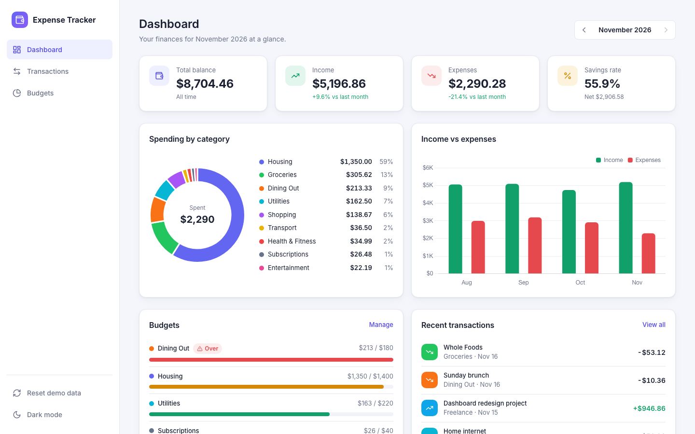

# Expense Tracker

A clean personal finance app built with Angular 21: track income and expenses, set monthly budgets per category and see where your money goes.

**[Live Demo](https://hkhodkar.github.io/expense-tracker/)**



## Features

- **Transactions** - add, edit and delete income and expenses with a validated form
- **Filters and search** - filter by date range, category and type, search by description or category, paginated table
- **Categories** - create your own income and expense categories, each with its own color
- **Monthly budgets** - set a limit per category, follow progress bars and get warned when you are close to or over budget
- **Dashboard** - balance, income, expenses and savings rate with month-over-month change, a spending-by-category doughnut and an income vs expenses trend chart
- **CSV import and export** - export the current (filtered) list, import CSV files from your bank or a spreadsheet; missing categories are created and duplicates are skipped
- **Works offline** - everything is stored in `localStorage`, no backend or account needed
- **Demo data** - about three months of realistic sample data on first visit, with a one-click reset
- **Dark mode** - follows your system preference and remembers your choice
- **Responsive** - usable on phones, tablets and desktops

## Tech Stack

- [Angular 21](https://angular.dev) - standalone components, signals, `computed` / `linkedSignal`, new control flow (`@if`, `@for`, `@let`), zoneless change detection, OnPush everywhere
- Typed reactive forms with custom validators
- Lazy-loaded routes
- [Chart.js](https://www.chartjs.org/) through a small Angular directive
- SCSS with CSS custom properties for light and dark themes (no UI library)
- [Vitest](https://vitest.dev/) for unit tests
- GitHub Actions + GitHub Pages for deployment

## Getting Started

Requirements: Node.js 20.19+ or 22.12+ and npm.

```bash
git clone https://github.com/hkhodkar/expense-tracker.git
cd expense-tracker
npm install
npm start
```

Then open http://localhost:4200.

Other useful commands:

```bash
npm test -- --watch=false   # run unit tests
npm run build               # production build in dist/
```

### CSV format

Exports use the columns below, and imports expect the same header (column order doesn't matter, `description` is optional):

```csv
date,type,category,amount,description
2026-11-03,expense,Groceries,64.20,Trader Joe's
2026-11-01,income,Salary,4250.00,Monthly salary
```

## Project Structure

```
src/
├── app/
│   ├── core/
│   │   ├── data/          # default categories and demo data generator
│   │   ├── models/        # Transaction, Category and filter types
│   │   ├── services/      # FinanceStore (signals + localStorage), theme, storage
│   │   └── utils/         # totals, budgets, filtering, CSV and date helpers (unit tested)
│   ├── features/
│   │   ├── dashboard/     # summary cards, charts, budget overview, recent activity
│   │   ├── transactions/  # table, filters, add/edit dialog, CSV import/export
│   │   └── budgets/       # budget progress per category, category management
│   ├── shared/
│   │   ├── directives/    # Chart.js directive
│   │   └── ui/            # modal, confirm dialog, toasts, icons, month picker, progress bar
│   ├── app.routes.ts      # lazy-loaded routes
│   └── app.ts             # layout shell with sidebar navigation
└── styles/                # theme variables, base styles and shared component styles
```

## Author

**Hatef Khodkar** - [github.com/hkhodkar](https://github.com/hkhodkar)

## License

[MIT](LICENSE)
